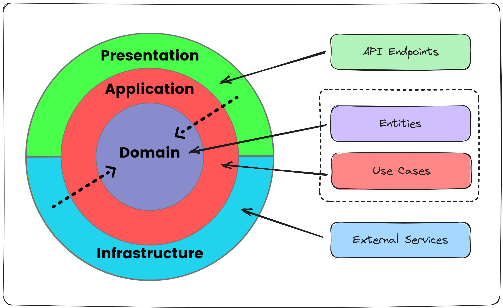

# Market.Backend

ASP.NET Core Web API (.NET 10). Pokretanje, korisnici i okruženja su opisani u [`../README.md`](../README.md).

| Projekat | Uloga |
|---|---|
| `Market.API` | kontroleri, middleware, autentifikacija i autorizacija (JWT, politika `Admin`), Swagger, CORS |
| `Market.Application` | CQRS komande i upiti (MediatR), validatori (FluentValidation), apstrakcije (`IAppDbContext`, `IAppCurrentUser`…) |
| `Market.Domain` | entiteti (`BaseEntity` sa soft delete i audit poljima) |
| `Market.Infrastructure` | EF Core `DatabaseContext`, konfiguracije entiteta, migracije, seederi, JWT servis, globalni exception handler |
| `Market.Shared` | DTO-i za greške (`ErrorDto`, `FieldErrorDto`), opcije, konstante |
| `Market.Tests` | unit i integracijski testovi (xUnit) |

## Pravila koja starter primjenjuje

- Brisanje je soft delete (`IsDeleted`); globalni query filter skriva obrisane zapise. Unique indeksi zato imaju filter `[IsDeleted] = 0`.
- Svaki endpoint traži prijavljenog korisnika, osim onih sa `[AllowAnonymous]`. Admin akcije imaju `[Authorize(Policy = PolicyNames.Admin)]`.
- Greške se vraćaju kao `ErrorDto`: 400 validacija (sa `errors` po polju), 401, 403, 404, 409 i 500.
- Datumi se u bazi čuvaju u UTC i u JSON-u idu sa oznakom `Z`.
- Tijela zahtjeva i odgovora se ne loguju (lozinke, tokeni).
- MediatR ostaje na verziji 12.x: od verzije 13 traži komercijalnu licencu.
